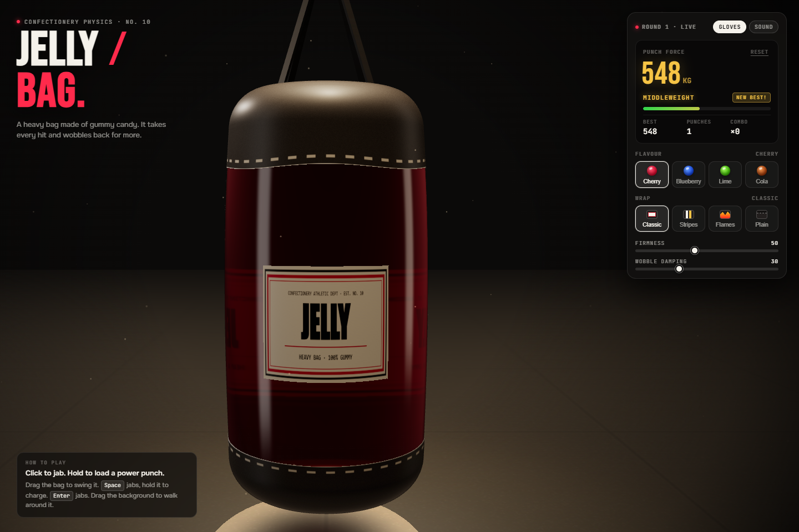
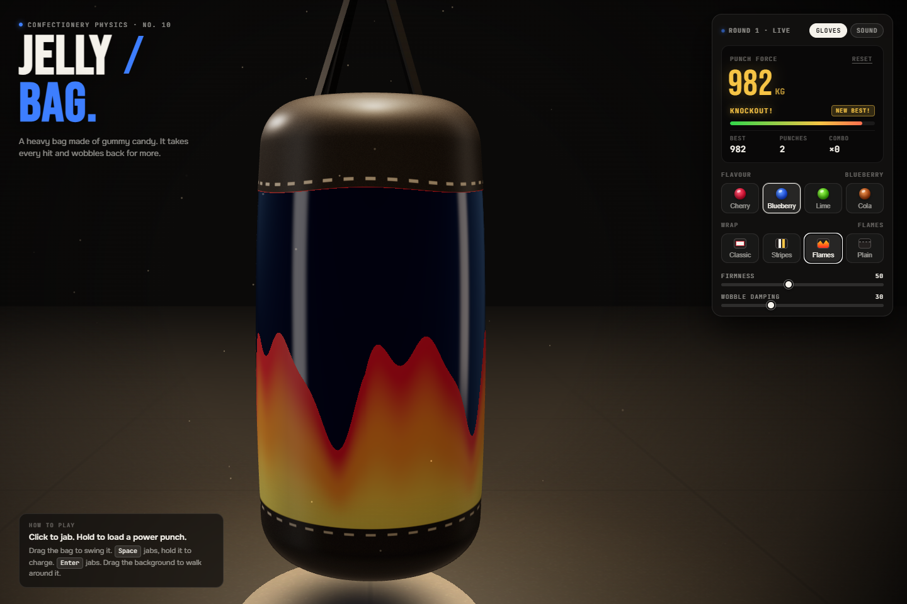

# Jelly Punching Bag

**Samsak dari permen jeli. Pukul, tarik, lalu lihat ia bergoyang kembali.**

Simulasi tinju 3D interaktif di browser dengan deformasi soft-body, material jeli transparan, dan skor pukulan bergaya arcade. Satu halaman HTML, tanpa instalasi aplikasi atau proses build.

**[Main sekarang di GitHub Pages](https://aldoprawiroa.github.io/Jelly-Punching-Bag/)** · **[Unduh v1.0.0](https://github.com/aldoprawiroa/Jelly-Punching-Bag/releases/tag/v1.0.0)** · **[Laporkan masalah](https://github.com/aldoprawiroa/Jelly-Punching-Bag/issues)**



## Langsung bermain

1. Buka **[Jelly Punching Bag](https://aldoprawiroa.github.io/Jelly-Punching-Bag/)** di browser modern dengan WebGL 2 dan akselerasi grafis aktif.
2. Klik atau ketuk samsak untuk melakukan **jab**. Dengan keyboard, tekan **Enter** atau ketuk **Space**.
3. Tahan klik, sentuhan, atau **Space** sekitar satu detik, lalu lepaskan untuk **power punch**. Usahakan tidak menggeser pointer saat mengisi tenaga.
4. Sambung pukulan dengan jeda maksimal **2,4 detik** untuk membangun combo. Coba kalahkan nilai **Best** milikmu.

Suara mati secara default. Klik **Sound** jika ingin mengaktifkan efek pukulan dan bel rekor baru. Tidak ada akun yang perlu dibuat.

> Angka **kg** adalah skor permainan yang dihitung dari tenaga, combo, dan variasi acak. Angka ini bukan pengukuran kekuatan fisik atau alat latihan tinju.

## Yang bisa kamu coba

| Fitur | Di dalam permainan |
| --- | --- |
| Samsak jeli 3D | Permukaan berubah bentuk saat terkena pukulan, lalu kembali bergetar. |
| Jab dan power punch | Pukulan singkat atau isi tenaga dengan indikator lingkaran. |
| Grab dan swing | Tarik samsak untuk mengayunkannya pada rantai. |
| Kamera interaktif | Putar sudut pandang dan zoom untuk melihat material dari dekat. |
| Empat flavour | Cherry, Blueberry, Lime, dan Cola, masing-masing dengan warna jeli berbeda. |
| Empat wrap | Classic, Stripes, Flames, dan Plain. |
| Pengaturan fisika | Sesuaikan **Firmness** dan **Wobble damping**. |
| Skor dan combo | Pantau Punch Force, Best, jumlah Punches, serta Combo. |
| Sarung tinju dan suara | Tampilkan/sembunyikan sarung tinju 3D dan aktifkan efek audio sintetis. |
| Rekor lokal | Best disimpan di browser melalui `localStorage` jika penyimpanan tersedia. |

### Tampilan alternatif



Kedua gambar merupakan tangkapan langsung permainan di browser, bukan ilustrasi atau mockup.

## Kontrol lengkap

| Aksi | Mouse / trackpad | Keyboard | Layar sentuh |
| --- | --- | --- | --- |
| Jab | Klik samsak | Enter atau tekan-lepas Space | Ketuk samsak |
| Power punch | Tahan klik pada samsak, lalu lepas | Tahan Space, lalu lepas | Tahan samsak, lalu lepas |
| Ayunkan samsak | Klik dan tarik samsak | — | Sentuh dan tarik samsak |
| Putar kamera | Tarik area latar belakang | Tombol panah | Tarik area latar belakang |
| Zoom | Scroll | — | Cubit dengan dua jari |
| Ganti tampilan | Klik Flavour atau Wrap | Tab untuk memindahkan fokus panel | Ketuk Flavour atau Wrap |

**Firmness** mengatur kekakuan jeli; nilai lebih rendah membuatnya lebih lentur. **Wobble damping** mengatur peredaman gerak; nilai lebih tinggi membuat getaran lebih cepat berhenti.

**Reset** menghapus skor saat ini, Best, jumlah pukulan, combo, dan rekor yang tersimpan di browser. Reset tidak mengembalikan posisi fisik samsak atau pilihan tampilannya.

### Skor dan rank

| Punch Force | Rank |
| --- | --- |
| Di bawah 300 kg | Featherweight |
| 300–479 kg | Lightweight |
| 480–649 kg | Middleweight |
| 650–819 kg | Heavyweight |
| 820 kg ke atas | Knockout! |

Combo berakhir setelah lebih dari 2,4 detik tanpa pukulan. Bonus skor bertambah 4% per sambungan, hingga bonus maksimal 40%. Skor dapat melewati 1.000 kg; tampilan meter daya tetap dibatasi pada panjang penuh.

## Menjalankan secara lokal

Tidak memerlukan `npm install`. Gunakan server file statis agar pemuatan modul berjalan melalui HTTP.

```bash
git clone https://github.com/aldoprawiroa/Jelly-Punching-Bag.git
cd Jelly-Punching-Bag
python -m http.server 8000
```

Buka **http://localhost:8000**. Di Windows, gunakan `py -m http.server 8000` jika perintah Python yang tersedia adalah `py`. Hentikan server dengan **Ctrl+C**.

Untuk memakai paket rilis, unduh dan ekstrak **Source code (zip)** dari [halaman Releases](https://github.com/aldoprawiroa/Jelly-Punching-Bag/releases), lalu jalankan server dari folder hasil ekstraksi.

### Kebutuhan

- Browser modern dengan **WebGL 2**, dukungan tekstur float GPU, dan akselerasi grafis yang memadai.
- Koneksi internet untuk mengambil **Three.js 0.160.0** dari jsDelivr dan font dari Google Fonts. Versi ini belum menyediakan paket offline.
- Python hanya diperlukan untuk contoh server lokal di atas; server statis lain juga dapat dipakai.
- Tidak ada backend, database, atau layanan akun. Rekor tidak tersinkron antarperangkat dan bisa hilang saat data situs dibersihkan atau sesi privat ditutup.

## Publikasi dengan GitHub Pages

Repositori ini memakai halaman statis pada branch **`main`**, folder **`/ (root)`**.

1. Push berkas ke branch `main` di GitHub.
2. Buka **Settings → Pages → Build and deployment**.
3. Pilih **Deploy from a branch**, branch **main**, folder **/ (root)**, lalu **Save**.
4. Tunggu deployment selesai. Statusnya dapat diperiksa melalui tab **Actions** atau halaman **Pages**.
5. Buka **https://aldoprawiroa.github.io/Jelly-Punching-Bag/**.

Berkas `.nojekyll` disertakan agar konten disajikan sebagai situs statis. Tidak diperlukan bundler, variabel lingkungan, atau konfigurasi domain. Untuk fork, sesuaikan URL menjadi `https://<username>.github.io/<nama-repositori>/`.

## Teknologi dan struktur

Rendering menggunakan [Three.js](https://threejs.org/) dengan WebGL 2. Geometri samsak dibentuk dari signed distance field menggunakan surface nets. Simulasi lattice soft-body menghasilkan deformasi yang dikirim ke shader melalui tekstur float. Efek suara dibuat lewat Web Audio API, tanpa berkas audio tambahan.

```text
Jelly-Punching-Bag/
├── index.html                     # Seluruh UI, rendering, fisika, dan interaksi
├── README.md                      # Panduan bermain dan menjalankan proyek
├── CHANGELOG.md                   # Catatan rilis
├── docs/
│   └── screenshots/
│       ├── gameplay-cherry.png
│       └── gameplay-blueberry.png
├── .gitignore
└── .nojekyll
```

Kode permainan dipertahankan dalam satu `index.html`. Tidak ada dependensi lokal atau tahap kompilasi.

## Troubleshooting

| Kendala | Yang dapat dilakukan |
| --- | --- |
| Pesan **WebGL 2 Required** | Perbarui browser, aktifkan akselerasi grafis, lalu coba lagi. Perangkat atau driver tertentu tetap dapat tidak mendukung fitur GPU yang dibutuhkan. |
| Kanvas kosong atau permainan tidak mulai | Pastikan internet tersedia dan jsDelivr tidak diblokir. Gunakan HTTP/HTTPS melalui server lokal atau Pages. Periksa console browser untuk kegagalan modul atau shader. |
| Gerakan terasa berat | Tutup tab/aplikasi berat, kecilkan ukuran jendela, dan coba perangkat dengan GPU lebih kuat. Beban simulasi bergantung pada perangkat. |
| Efek suara tidak terdengar | Klik **Sound**, lakukan pukulan, lalu periksa volume dan status mute tab. Audio memerlukan interaksi pengguna. |
| Best kembali nol | Periksa apakah data situs dihapus, memakai mode privat, menekan Reset, atau membuka origin/browser berbeda. |
| Link Pages menampilkan 404 | Pastikan branch `main` sudah dipush, sumber Pages menunjuk root, dan deployment pertama sudah selesai. Perhatikan huruf besar/kecil nama repositori. |

## Kontribusi dan hak penggunaan

Temukan bug? [Buat issue](https://github.com/aldoprawiroa/Jelly-Punching-Bag/issues/new) dengan langkah reproduksi, browser, perangkat/GPU, dan screenshot atau pesan console yang relevan. Hindari menyertakan data pribadi.

Perubahan dapat diajukan melalui pull request. Sertakan penjelasan singkat serta hasil pemeriksaan di browser; untuk perubahan visual, lampirkan screenshot sebelum dan sesudah.

Proyek oleh **[aldoprawiroa](https://github.com/aldoprawiroa)**. Repositori ini belum menetapkan lisensi untuk kode proyek; ketersediaan publik tidak otomatis memberikan izin penggunaan ulang. Three.js dan font pihak ketiga mengikuti lisensi masing-masing.

Lihat [CHANGELOG.md](CHANGELOG.md) untuk catatan versi dan [Releases](https://github.com/aldoprawiroa/Jelly-Punching-Bag/releases) untuk arsip sumber.
